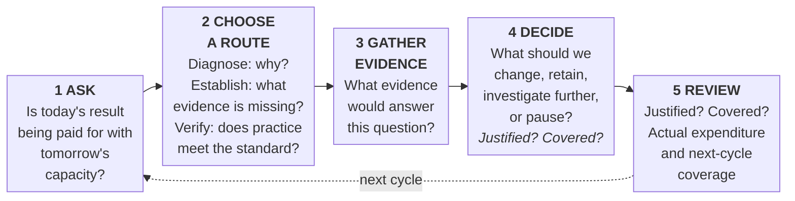

# Human Energy Economics (HEE)

**Md. Mozammel Hoque** · Independent Management Researcher · Originator of Human Energy Economics (HEE)

**Your results show what you achieved. Do they show what capacity you have left to achieve it again?**

Organizations can achieve their targets without fully understanding what those results have consumed, what capacity remains, or whether the conditions for future execution are being strengthened or degraded.

Human Energy Economics (HEE) is a practice-driven management approach that helps organizations examine the capacity behind their results, identify what limits application, and consider what must change to sustain execution across successive cycles.

**The central concern:** Not only what the organization achieves, but whether it can continue achieving valuable results without unnecessarily degrading the capacity required to do it again.

**The approach:** HEE does not treat management as one formula for every situation. It is a way to organize your questions, and it comes from practice. Each problem is examined on its own terms. Practitioners use evidence and judgment to choose, adapt, and review what fits the context. HEE supports judgment that is based on evidence; it does not replace judgment.

HEE draws on the author’s experience, knowledge, and wisdom, including applications and observed results reported by the author. Readers are invited to test HEE in their own setting and, if they do not see the result they expect, to write to the author (see the author’s note). The [evidence note](#what-hee-isand-is-not) near the end says what is and is not established.

**Purpose.** HEE is a practice-driven approach. It is meant to help readers make sound decisions about what matters to the people affected. It asks for evidence that fits the stakes, and it keeps the reasoning open to review. The aim is consistent, successful execution with sustainable growth. You are invited to bring your own questions, described by their Time, Object, and Location, and to judge for yourself whether HEE helps.

**Evidence labels in this Profile:** [Illustrative] means an invented example. [H] means a practice heuristic, a rule of thumb from practice. The Core README explains all the labels.

**Jump to:** [Reader’s guide](#readers-guide) · [Start with your context](#start-with-your-context-when-what-and-where) · [Find Your Situation](#find-your-situation) · [Find Your Question](#find-your-question) · [Explore HEE](#explore-hee) · [Two Checks](#two-checks-shortfall-or-justified-spending) · [Three Investigation Routes](#three-investigation-routes-diagnose-establish-verify) · [Better, Faster Decisions](#better-faster-decisions) · [Evidence note](#what-hee-isand-is-not) · [LICENSE](#license)

---

## Built through practice

HEE is a result of the author’s past and present experience, knowledge, and wisdom. It is practice-driven and practical. Readers are invited to recognize HEE’s questions and reasoning in the author’s practice cases in [HEE Case Studies](https://github.com/titumozammel/hee-case-studies), consider what fits their own context, and apply it with proportionate evidence and judgment. It follows a path from observation to research to application and execution: investigating each problem in its specific context, acting on it, working proactively to prevent recurrence, and supporting sustainable results. The author reports positive results from applying this practice in current and previous roles; specific outcomes are not detailed in this passage and have not been independently verified. HEE’s questions are not specific to any sector. Readers are invited to adapt them to businesses, public services, nonprofits, schools, and individual learning. Application in the author’s professional roles does not by itself show suitability for every setting, so check the context first. The fuller personal account is in the author’s note at the end.

## Reader's guide

This Profile is the top-level navigation document for HEE; the Core README is authoritative for definitions, evidence, and research detail. You do not need to read all of HEE. This guide shows where to enter for your role, what you can take away, and what you can defer on a first reading.

| Audience | What you can take away | Start here | First useful step | Suggested time |
| --- | --- | --- | --- | --- |
| **Board and audit committee** | Two Checks: a way to separate justified spending from a future-capacity shortfall | [Board report (Core)](https://github.com/titumozammel/human-energy-economics#board-report-one-page-multi-capital-h), [Two Checks: Shortfall or Justified Spending?](#two-checks-shortfall-or-justified-spending). Then skim: [Better, Faster Decisions](#better-faster-decisions) | Ask separately: was the capacity expenditure justified, and does credible expected usable capacity cover legitimate next-cycle demand? | 10 min |
| **CEO, C-suite, and owners** | A way to see what results have consumed and what capacity remains | [HEE at a Glance](#hee-at-a-glance), [Owner brief (Core)](https://github.com/titumozammel/human-energy-economics#the-owner-brief-decision-guide-h). Then skim: [Better, Faster Decisions](#better-faster-decisions) | Review whether last-cycle expenditure was justified; assess whether next-cycle legitimate demand is covered | 15 min |
| **Operations managers and team leaders** | The sentence that sounds like your week, mapped to the right tool | [Find Your Situation](#find-your-situation). Then skim: [Three Investigation Routes: Diagnose, Establish, Verify](#three-investigation-routes-diagnose-establish-verify) | Open the one framework your situation points to and read its Use it today card | 15 min |
| **Practitioners and consultants** | Three investigation routes and the Field Guide | [Three Investigation Routes: Diagnose, Establish, Verify](#three-investigation-routes-diagnose-establish-verify), [Field Guide (Core)](https://github.com/titumozammel/human-energy-economics#practitioner-field-guide). Then skim: [What Determines the Capacity Behind Results?](#what-determines-the-capacity-behind-results) | Start with Field Triage on one live problem | 30 min |
| **Academics** | What HEE claims, what it does not, and where the evidence detail sits | [What HEE Is—and Is Not](#what-hee-isand-is-not), [What HEE claims (Core)](https://github.com/titumozammel/human-energy-economics#3-what-hee-claims-and-what-it-does-not). Then skim: [Three Investigation Routes: Diagnose, Establish, Verify](#three-investigation-routes-diagnose-establish-verify) | Read the Core’s evidence map before its propositions | 20 min |
| **Researchers** | The research routes and study designs, kept in the Core | [Falsification summary (Core)](https://github.com/titumozammel/human-energy-economics#falsification-summary-where-to-start-p), [Open limits (Core)](https://github.com/titumozammel/human-energy-economics#open-limits-at-version-10-p). Then skim: [Two Checks: Shortfall or Justified Spending?](#two-checks-shortfall-or-justified-spending) | Pick a proposition, check its prerequisites and design, and name evidence that would support, narrow, or reject it | 20 min |
| **New to HEE** | What HEE is in plain words, and how to use it | [HEE at a Glance](#hee-at-a-glance). Then skim: [Find Your Question](#find-your-question) | Read the four questions, then pick one row from Find Your Situation | 10 min |

*Times are suggested allocations, not measured; reading speeds differ. Take-aways describe what a reader can use, not an outcome this document can assure. The first useful step is a suggestion; the decision stays yours.*

**First step for every role:** write one line each for your Time, Object, and Location ([Start with your context](#start-with-your-context-when-what-and-where)), then use the role row that fits.

**Only five minutes?** Read [Find Your Situation](#find-your-situation), pick the row that sounds like your week, and open the tool beside it.

**You can defer on a first reading:** the Core README’s research and reference sections, unless you are an academic or researcher. Read the evidence note before applying the guidance.

## Start with your context: when, what, and where?

**(Time, Object, and Location) [H]** HEE helps you look at each situation through three things: Time, Object, and Location. Then you decide which conditions to keep, change, or stop. This frame organizes your questions; it does not replace them. You still need to examine objectives, evidence, dependencies, constraints, and consequences.

*Time* is when: the timing, how often, how long, the cycle, and the window for the decision. *Object* identifies the concerns that materially matter to this inquiry: those that could reasonably change the decision, the usable capacity, or a consequential result for those affected. Many concerns may be present (a process, a drain, people, a role, an objective, a vision, a mission, a goal). Write down which ones you set aside, and why. *Location* is where: the physical setting, the culture, the conditions, and related factors.

In the author’s practice, context guides the focus and shapes the questions. Evidence can support the diagnosis (**Diagnose**), reduce decision-relevant uncertainty before a decision (**Establish**), or check practice against a standard (**Verify**). What the evidence shows informs the action. The [Decision Point](#the-decision-point) supports review before commitment and after outcomes emerge. Write one line each for Time, Object, and Location, and compare them with those of any case you read before applying its lessons. HEE applies where the Object affects capacity, demand, application, or execution. This frame is a guide, not a required sequence, and others have not yet tested it. The [3C Strategic Approach](https://github.com/titumozammel/3c-strategic-approach) is used inside this frame: its three contexts (Source, Dependency, Constraint) are lenses for looking at a condition, and they are distinct from the frame.

*A useful next step: find your situation below.*

---

## Find Your Situation

**Start with your work.** You do not need to learn HEE’s terms first. Bring one situation, read a relevant example, and use the questions that help you decide what to do next. HEE puts lessons from practice in order. Use it together with the methods you already use. Read more only when your situation needs it.

Ask the question beside the sentence that sounds like your week, and open the one tool it points to.

| Your situation | Ask this first | What you will explore | Start here |
| --- | --- | --- | --- |
| "We hit the target, but the team is exhausted." | Was the capacity expenditure justified, and is next cycle covered? | Why a justified expenditure and a future-capacity shortfall are separate judgments | [Two Checks](https://github.com/titumozammel/human-energy-economics#justified-spending-or-future-shortfall-one-page-card-hp) |
| "Capable people are waiting for access, approval, or decisions." | Is capability missing, is its application blocked, or are both happening together? | How to tell development needs from enablement barriers, and what to do when both occur | [Human Energy Enablement (HEEn)](https://github.com/titumozammel/human-energy-enablement#use-it-today) |
| "The same reports, approvals, chasing, or rework keep returning." | What purpose does this work serve, and what keeps generating it? | Whether recurring demand should be kept, redesigned, or questioned | [Operational Silence Framework (OSF)](https://github.com/titumozammel/operational-silence-framework#use-it-today) |
| "We fix the problem, and it returns." | Did the response change the condition that produces the problem? | How to investigate recurrence and check whether a change holds | [Execution Excellence System (EES)](https://github.com/titumozammel/execution-excellence-system#use-it-today) |
| "Several things seem wrong. We do not know where to begin." | What creates the problem, what depends on it, and what limits action? | How to frame an inquiry before choosing an intervention | [3C Strategic Approach](https://github.com/titumozammel/3c-strategic-approach#use-it-today) |
| "We want to simplify something, but it may serve an important purpose." | What would changing it protect, improve, or put at risk? | How to weigh keeping, reducing, replacing, redesigning, or removing it | [5R Cascade Framework](https://github.com/titumozammel/5r-cascade-framework#use-it-today) (Remove · Reduce · Replace · Re-engineer · Retain) |

*This table is a summary. No table can list every situation, so these six are common starting points for inquiry, not diagnoses. Your situation may fit more than one row, or none exactly; if none fits, state what you want to achieve, prevent, understand, or verify, describe the relevant context, and start with the [Practitioner Field Guide](https://github.com/titumozammel/human-energy-economics#practitioner-field-guide).*

**Feeling worn down at work?** Start by examining work demands and conditions. See [Three rules that do not bend](https://github.com/titumozammel/human-energy-economics#three-rules-that-do-not-bend-h).

Each of the five companion repositories (HEEn, OSF, EES, 3C, and 5R) opens with a one-page **Use it today** card: when to use it, three questions, and a worked example explained step by step. Two Checks is a section of the Core README. The examples are marked **[Illustrative]**: they are invented to show the thinking, not reported results. Prefer to start from a question instead of a situation? See **Find Your Question**.

**What you will find is a better question about your own situation. The decision stays yours.**

*One situation → a relevant example → a useful question → a next step your evidence supports.*

---

## Find Your Question

**Find Your Situation** tells you where to begin when you recognize your week. **Find Your Question** is the other way in: use it when you already know what you need to understand or decide. Either way, each answer points to the section of the Core README or companion repository that addresses it.

| Question | Primary function | Asked by | Answered in | Decision it unlocks |
| --- | --- | --- | --- | --- |
| What is HEE, and when might I use it? | Understand scope | New readers | [New to HEE? Start here](https://github.com/titumozammel/human-energy-economics#new-to-hee-start-here): plain-language explanation and a short exercise | Whether to explore HEE further |
| What should we decide now, and what evidence is enough? | Make a supported choice | Owners and executives | [Decision Speed Card](https://github.com/titumozammel/human-energy-economics#decision-speed-card-h): decision tiers and proportionate evidence requirements; [owner brief](https://github.com/titumozammel/human-energy-economics#the-owner-brief-decision-guide-h) | Decide now, run a small test, investigate, or escalate |
| Why is execution falling short? | Investigate causes | Managers and practitioners | [Practitioner Field Guide](https://github.com/titumozammel/human-energy-economics#practitioner-field-guide): Field Triage, competing explanations, and evidence gathering | Which explanation to test first |
| Was the capacity expenditure justified, and is next cycle covered? | Assess expenditure and future demand | Owners, operations, finance, and HR | [Two Checks](https://github.com/titumozammel/human-energy-economics#justified-spending-or-future-shortfall-one-page-card-hp): two separate judgments and four coverage states | Proceed, protect or renew capacity, adjust commitments, or record Unknown with the evidence needed |
| Which conditions block my team’s existing capability from being applied? | Investigate blocked application | Managers, practitioners, and owners | [Human Energy Enablement (HEEn)](https://github.com/titumozammel/human-energy-enablement): six pillars, with Diagnose, Establish, and Verify routes | Which enablement barrier to test, or whether the cause lies elsewhere |
| What should someone in my function ask or do? | Apply a role perspective | Functional leads: finance, HR, operations, IT, risk, and others | [Find by role](https://github.com/titumozammel/human-energy-economics#find-by-role-h): locate your function, then use its [role answer card](https://github.com/titumozammel/human-energy-economics#role-answer-cards-h) for function-specific questions and evidence needs; the Core README’s [answer contract](https://github.com/titumozammel/human-energy-economics#the-answer-contract-h) sets out how a role-based answer is built | Which role-specific question and evidence to use |
| Feeling worn down at work, what should I examine first? | Examine work demands and conditions | Individual employees | [Three rules that do not bend](https://github.com/titumozammel/human-energy-economics#three-rules-that-do-not-bend-h): the question is about work conditions, not a diagnosis of you | Which work-condition inquiry or conversation with a manager is appropriate |
| How do employee and customer experience inform sustainable growth? | Examine connected evidence | Leaders, HR, operations, and customer teams | [EX, CX, and Sustainable Growth](https://github.com/titumozammel/human-energy-economics#employee-experience-customer-experience-and-sustainable-growth-p): relationships and evidence limits | What additional evidence to examine |
| Does practice meet the stated requirement? | Verify practice | Auditors, risk teams, and independent reviewers | [Diagnosis and audit route](https://github.com/titumozammel/human-energy-economics#diagnosis-and-audit-route-h): criteria, traceable evidence, and findings; then, to check whether a diagnosis has a defensible evidence trail, the [independent review checklist](https://github.com/titumozammel/human-energy-economics#independent-review-checklist-h) | Accept, correct, escalate, or investigate |
| What does HEE add, and what is the evidence behind it? | Assess contribution | Academics | [What HEE contributes](https://github.com/titumozammel/human-energy-economics#2-what-does-hee-contribute): the additions; then the [evidence map](https://github.com/titumozammel/human-energy-economics#14-evidence-map-research-facing) for their boundaries | Which contribution claims warrant comparison or testing |
| How can a claim be tested? | Design research | Researchers and independent reviewers | [Falsification summary](https://github.com/titumozammel/human-energy-economics#falsification-summary-where-to-start-p): research designs and revision conditions | Which study can support, narrow, or challenge a claim |
| What do the practice cases actually establish? | Assess practice evidence | Practitioners, academics, and researchers | [HEE Case Studies](https://github.com/titumozammel/hee-case-studies): eight examples from the author’s experience, with unavailable fields marked Not recorded | Whether a case informs application or only a hypothesis |

This table is a summary of common questions; no table can list every question you may have. It is a public-facing subset. The Core README’s question map, with stable question IDs (A1, B1, and so on), is authoritative: it lists each question with its primary function, who asks it, where it is answered, and the decision it unlocks, and it routes job-role questions (finance, HR, operations, IT, risk, and others) to the right section.

---

## Explore HEE

**Prefer to browse? Here are all the repositories. If you are unsure where to begin, use Find Your Situation or Find Your Question above.**

| Repository | What it holds | Start here if you want to… |
|---|---|---|
| [Author GitHub Profile](https://github.com/titumozammel) | The originator's profile and repositories | See the author's other work |
| [Human Energy Economics (Core README)](https://github.com/titumozammel/human-energy-economics) (authoritative) | Full concepts, diagnostic logic, decision architecture, evidence boundaries, and research designs | Understand HEE in depth, or check what it does and does not claim |
| [HEE Case Studies](https://github.com/titumozammel/hee-case-studies) | Eight examples from the author’s experience: one from RR Transport, one from Bismillah Transport, and six from Abul Khair Group. A practice record that generates hypotheses; it is not proof | See HEE applied, and what the cases do and do not establish |
| [Operational Silence Framework](https://github.com/titumozammel/operational-silence-framework) | Recurring demand, noise, or complexity that consumes capacity | Work out why recurring demand keeps consuming capacity |
| [3C Strategic Approach](https://github.com/titumozammel/3c-strategic-approach) | Source, Dependency, Constraint | Frame where a condition comes from, what depends on it, and what limits action |
| [5R Cascade Framework](https://github.com/titumozammel/5r-cascade-framework) | Remove, Reduce, Replace, Re-engineer, Retain | Test whether recurring work is necessary and how it could change |
| [Human Energy Enablement](https://github.com/titumozammel/human-energy-enablement) | Cases where capability exists but application is blocked | Find what blocks people from applying what they can already do |
| [Execution Excellence System](https://github.com/titumozammel/execution-excellence-system) | What prevents reliable execution, and how to fix it and make it hold | Make a fix hold, so execution stays reliable |

Also: [Website](https://ovinabo.com/) · [LinkedIn](https://www.linkedin.com/in/mozammel-hee)

---

## HEE at a Glance

### 1. What is HEE?

Human Energy Economics (HEE) is a capacity lens informed by economic questions about scarcity, opportunity cost, renewal, and future value. The word *Economics* in the name refers to those questions: HEE does not present a formal economic model or claim predictive economic validity. It is a practice-driven management approach to organizational capacity and sustainable execution.

*Practice-driven* means derived from practice (organizational problems, observations, and experience), applied in the author’s practice (author-reported), and designed for practitioners (investigation, evidence gathering, decisions, and review). The [Core README](https://github.com/titumozammel/human-energy-economics#4-core-definitions) holds the full definition.

HEE treats human energy (the cognitive, emotional, and physical capacity people bring to work) as a management resource that can be consumed, depleted, protected, and renewed. **Capability** is what people can do; **capacity** is how much of it can be applied; **enablement** is the work conditions that let it be applied.

**Precision statement.** HEE examines whether current results are being achieved at the expense of capacity needed for future work. It asks two separate questions, *Justified?* and *Covered?*; a justified expenditure can still leave a future-capacity shortfall. It is not a clinical tool, a compliance method, or a substitute for specialist judgment.

**Core idea.** Organizations do not sustain performance merely by possessing resources, people, or capability. They sustain it by preserving, developing, connecting, enabling, mobilizing, and applying those assets repeatedly, without unnecessarily degrading the capacity required to do it again. *Extraction depletes. Cultivation compounds.*

### 2. What does HEE contribute?

HEE offers one connected way to move from an observed performance question to a reviewable decision: question → method → evidence → decision → follow-up. Readers choose a route: **diagnose** why a problem is occurring, **establish** the evidence still missing, or **verify** practice against a stated criterion.

Three distinctions run through that inquiry. It asks what **limits or blocks** capability from becoming effective execution. It separates whether capacity was spent for a justified purpose from whether enough capacity will be available next cycle. And it treats employee experience, customer experience, and Sustainable Growth as connected evidence to examine, not an assumed causal chain.

HEE is intended to help owners make clearer, better-supported decisions and understand their consequences; give practitioners a route from an observed problem to a defensible intervention; give academics and researchers material to compare and test; and give reviewers an evidence trail they can re-perform.

### Why HEE matters

Results show what an organization achieved. They do not show whether the capacity behind them is being renewed or used up. HEE’s emphasis is on one added question, alongside the questions you already ask about work, waste, and delay:

> **Is today’s result being paid for with tomorrow’s capacity?**

This question organizes HEE’s practical contribution: the Two Checks, the investigation routes, and the companion frameworks are ways to answer it with evidence. Whether it helps in your setting is for you to judge.

One observation from the author’s practice (see the author’s note at the end), author-reported and not independently verified: customer experience comes first, and sustained customer experience appeared to depend on the work conditions supporting employees. HEE gives that observation a form that others can examine. Treat it as a question to investigate in your setting, not a rule to assume.

### How HEE helps you work through an execution problem

1. **Start with the problem, not the solution.** Name one gap between what should happen and what does.
2. **Ask the Two Checks.** *Justified?* Was the capacity expenditure warranted and proportionate to its purpose? *Covered?* Does credible expected usable capacity meet next cycle’s legitimate demand?
3. **Examine what is limiting.** It may be drain (consumption without sufficient contribution or legitimate future value), missing capability, blocked application, or several together. Look at the evidence for each before settling on one (see the [Vocabulary sheet](https://github.com/titumozammel/human-energy-economics#vocabulary-sheet-acronym-decoder-h)).
4. **Choose a response the evidence supports.** Depending on what you find, that may be to protect or recover capacity, to develop, connect, or enable it, or to remove, reduce, replace, re-engineer, or retain recurring demand.
5. **Check what held.** Look again next cycle.

*These five steps provide a brief overview; the Core README explains the [six practitioner moves](https://github.com/titumozammel/human-energy-economics#the-six-practitioner-moves-h) in full.*

### Works alongside what you already use

HEE is a practice-driven approach that works alongside existing management ideas and does not replace any of them. Each row shows what you may already use and a question to examine alongside it.

| If you already use… | It helps you ask… | A question to examine alongside it… |
|---|---|---|
| **Goals and targets** (OKRs, Balanced Scorecard) | Are we aiming at the right results? | Will next cycle's usable capacity cover them? |
| **Process improvement** (Lean, Six Sigma) | Where is the waste or variation? | Is the improvement itself drawing on capacity that must be renewed? |
| **Constraints thinking** (Theory of Constraints) | What limits output? | Is capability missing, or is existing capability unable to be applied? |
| **Engagement and wellbeing** | How do people experience their work? | How does that relate to the capacity left for next cycle? |
| **Change management** | Will people adopt the change? | Can the organization sustain it after the launch effort? |
| **Cost and performance measurement** | What does the output cost, and is it on target? | How much of the energy used served a justified purpose, and how much was drain? |

*Start with the right-hand column: the left columns name what you already use, and the right column is a question to examine alongside your existing approach.*

**Choosing a method.** Use the method the question requires. Where OKRs, Lean, or another established approach already addresses the task, continue using it. Bring HEE’s questions alongside it when you need to examine capacity consumption, blocked application, or future coverage. HEE does not need to lead every investigation.

### Three terms used in HEE

| Term | Plain meaning | How to tell it apart (illustrative) |
|---|---|---|
| **Drain** | Capacity consumed without sufficient productive contribution or legitimate future value. Consumption is not automatically drain. | *Capacity consumption without sufficient contribution.* Hours spent re-keying the same data into two systems that no one reconciles. |
| **Human Energy Leakage** | The mechanism: unnecessary consumption, diversion, fragmentation, or trapping of Human Energy. | *How it is lost.* The duplicate entry is the route by which those hours drain away. |
| **Human Energy Liberation** | A way of investigating and redesigning the recurring unnecessary conditions that create or sustain leakage; an orientation, not a separate intervention. | *The direction of the response.* Ask why the duplicate step exists and redesign the condition that keeps it, rather than asking people to work harder around it. |

*Note: Drain Condition, one of the seven diagnostic conditions in the Diagnostic Approach below, is where these terms are applied to a specific situation.*

*Definitions are in the [Core README](https://github.com/titumozammel/human-energy-economics#vocabulary-sheet-acronym-decoder-h).*

### 3. How do I apply it to my problem?

**Context shapes the route.** Every problem, situation, or condition has a context that matters to the decision. The result of any management approach, including HEE, depends on the context. *Context* here means the Time, Object, and Location frame described in [Start with your context](#start-with-your-context-when-what-and-where). HEE therefore does not prescribe one uniform flow for every case.

Choose and combine its investigation routes according to the question: **Diagnose** to investigate possible causes, **Establish** to gather evidence needed for a defensible determination, and **Verify** to check practice against a stated standard. These routes are not compulsory sequential stages. Reconsider the route as evidence or conditions change.

The aim is a better-supported decision about how to pursue the goal; the outcome depends on context.

#### HEE’s central management question

**Is today’s result being paid for with tomorrow’s capacity?**

*An orientation map; revisit any step as needed.*

Apply the two checks twice: before choosing an action (step 4; would the expenditure be *Justified?* would next cycle’s demand stay *Covered?*) and against actual expenditure and coverage (step 5). A defensible decision may retain the current arrangement, request more evidence, or take precautionary action. When the evidence points to a change, ask the second canonical question: **Which condition must change next—and will that change protect, renew, or consume the next cycle’s capacity?**

**Signature question:** *What prevents the capability we have from becoming execution—and what must change next?* Its companion “limits form,” used when the evidence points to a boundary or constraint, is: *What limits the capability we have from becoming execution—and what must change next?*

### 4. How should I use HEE?

HEE is a practice-driven approach for asking better questions and reviewing decisions with your own evidence and judgment. It supports inquiry; it does not replace specialist judgment. Use proportionate evidence, record uncertainty, and keep illustrative examples and author-reported observations separate from independent findings. What is and is not established is set out in the [evidence note](#what-hee-isand-is-not).

### Value and Sustainable Growth

HEE examines how organizations create, lose, recover, protect, apply, and sustain the capacity required for repeated execution and continuing value creation. It treats Organizational Capacity as an economic concern and asks questions about scarcity, opportunity cost, renewal, and future value. HEE is not a formal economic model, and it does not claim that Human Energy alone determines performance.

- **Value:** Consequential outcomes for relevant stakeholders and the systems the organization depends on, across the six capitals: financial, manufactured, intellectual, human, social and relationship, and natural. Value is not identical to activity, output, or financial profit.
- **Sustainable Growth:** The continuing creation and renewal of value across the six capitals without degrading the capacity required for future value creation. Profit alone cannot establish sustainable growth if other capitals or future capacity are being depleted. The full definitions and the six-capitals table are in Core [§4.1](https://github.com/titumozammel/human-energy-economics#41-value-and-sustainable-growth-the-six-capitals).

---

## Two Checks: Shortfall or Justified Spending?

Spending capacity is not a failure in itself. HEE separates two checks and then a coverage state: whether the expenditure was justified, and whether next-cycle demand is covered. A justified expenditure can still leave a shortfall. The Two Checks are decision questions, not a diagnosis; the investigation routes that follow support them according to what needs answering.

- **Justified?** Was the capacity spent for a stated purpose, in proportion to it? Answer yes, partly, or no. If partly, separate the justified part from the excess.
- **Covered?** Does credible expected usable capacity meet the next cycle’s legitimate demand across plausible scenarios, with the required capability and access? If the forecast depends on renewal, is that renewal feasible, timely, resourced, and owned?

**In practice:** Covered supports proceeding subject to justification and necessary safeguards. Fragile requires a credible contingency; without one, retain Fragile in the record and act precautionarily as if Not covered. For Not covered, reduce or reschedule commitments, or secure feasible, timely capacity and reassess coverage. For Unknown, name the evidence needed, its owner, and a decide-by date. The table below gives the full default move for each state; this paragraph is the owner-facing summary.

| Coverage state | What it means | Default move |
| --- | --- | --- |
| **Covered** | Expected capacity covers legitimate demand in every plausible scenario | Proceed; schedule a renewal check |
| **Fragile** | The base case is covered, but a plausible scenario creates a material gap | Proceed only with a credible contingency: a named person, a scheduled slot, the resource or authority, and a trigger date. If any is missing or infeasible, retain Fragile as the evidence state and act as if Not covered |
| **Not covered** | The base case has a material gap, or a required capability or access is unavailable | Name a renewal owner, slot, resources, and deadline, or reduce next-cycle commitments |
| **Unknown** | Evidence is too weak for a defensible comparison | Name the evidence that would decide, who gets it, and a decide-by date. If that date passes without decisive evidence, retain Unknown as the evidence state and act as if Not covered for this decision, reduce commitments, or escalate to the owner who can create a feasible contingency |

*These default moves are heuristics. Where evidence warrants a different action, record the rationale, authority, safeguards, and review date; keep the evidence state unchanged.*

**A worked contrast [Illustrative].** The numbers are invented to show the logic, not evidence of a real case. A support team works heavy overtime for two weeks to resolve a product recall. The work was *justified*, but next month's normal demand will not be *covered* because no one has recovered: justified spending with a candidate future shortfall, so the owner names a renewal plan or reduces next-month commitments. Another team spends the same overtime re-keying data between two systems. That work is *not justified*, yet next month is *covered* because the team has slack: a drain candidate, not an emergency, so the owner schedules the system fix. Same overtime, different decisions, and results alone would not have told them apart.

**A cash-flavoured contrast [Illustrative].** The numbers are invented. A distribution team defers 40,000 (currency units) of vehicle maintenance for two quarters to meet a cost target. Next quarter the legitimate delivery demand is 100 vehicle-days, but credible usable capacity is 85 because breakdowns have risen. The immediate cash outflow was reduced, but net savings are not established. Was the deferral justified? Unknown without evidence about maintenance requirements, risks, alternatives, and expected costs. Is next quarter covered? Not covered under the stated forecast: 85 vehicle-days against demand of 100. The owner must secure feasible capacity or adjust commitments while preserving required safeguards, then reassess coverage. A target achieved, expenditure justified, and future demand covered are separate judgments.

**A partly justified example [Illustrative].** The numbers are invented. A production team works 60 hours of overtime in a month. A review assesses the hours for necessity, proportionality, and alternatives. It first sorts them by source: about 35 hours answered a genuine order surge, and 25 were rework caused by a recurring planning error. Sorting by source does not decide justification, because neither type is automatic. A genuine surge does not justify every hour, and rework does not make every hour unjustified, since correcting faulty work before it reaches customers may be necessary.

The review then tests each block against the three criteria (necessity, proportionality, and alternatives), which are parts of the justification check, not a third check. It finds that 30 of the surge hours were proportionate to the demand, and 5 were more than the surge required because rescheduling was available. It finds that 10 of the rework hours were necessary to correct faulty work before shipment, and 15 repeated a fault that an earlier check could have caught. So 40 hours were warranted and proportionate, and 20 were not.

*Justified?* Partly: 40 of 60. If the review had not yet reached these findings, justification would stay Unknown rather than Partly.

*Covered?* Next month's legitimate demand is 120 team-hours a week, but credible usable capacity is 110 because people are tired and two are absent. That is Not covered. A partly justified expense with Not covered is high priority.

The owner protects the justified response to demand and the correction of faulty work where it is needed. The drain candidates are the 20 excess hours and the avoidable planning condition that generated the rework. Fixing that condition may release capacity without asking for more overtime. Whether it does is for the team to test.

*In short: sort by source, then test each block against necessity, proportionality, and alternatives. Until that review is done, justification is Unknown, not Partly.*

**A learning example [Illustrative].** The numbers are invented. A student studies until midnight for a week to finish a project by its deadline. *Justified?* Partly: the deadline was real, but about a third of the late hours went on recopying notes that a simple outline would have avoided. *Covered?* Next week's exams need about 10 hours of study, and the student, tired from the week, can credibly give six usable hours after allowing for recovery and other commitments. That is Not covered. The student protects sleep, moves non-essential tasks, and asks the teacher whether any exam preparation can be spread out, then reviews at the end of next week whether the plan held. The same two questions work in other settings. Adapt the words to the learner's age and context; a younger student may answer the second question with a teacher or parent.

**Read the two checks together.** Justified and Covered is justified expenditure. Justified and Not covered is justified spending with a candidate future shortfall. Not or partly justified and Covered is a drain candidate, not an emergency. Not or partly justified and Not covered is high priority.

A recovery plan makes renewal credible only when it is feasible, timely, resourced, and owned; its existence alone is insufficient, and it does not by itself make coverage sufficient. The accountable owner makes the judgment, and for consequential decisions a second person who does not own the result checks it. Tier 1 decisions (low stakes, easily reversed) do not require a second-person check; evidence and proportionate safeguards still apply. A Tier 1 call is self-assessed by the accountable owner. These are decision questions and states, not scores.

*A useful next step: if either answer is Unknown, name the evidence needed, who gets it, and a decide-by date.*

---

## Three Investigation Routes: Diagnose, Establish, Verify

HEE offers three investigation routes, chosen according to the question: Diagnose investigates possible causes; Establish gathers evidence needed for a defensible decision; Verify checks practice against a stated requirement. The routes can inform one another and are not mandatory sequential stages. Use the route the question calls for; you do not need all three.

*The investigation routes describe the task; the Core README’s [six practitioner moves](https://github.com/titumozammel/human-energy-economics#the-six-practitioner-moves-h) guide the practical work. They are not additional sequential stages. Establish can gather evidence for any decision, including within a diagnosis. Verify compares practice against a stated requirement and may use the independent review checklist.*

### 1. The Diagnostic Approach — Troubleshooting and Problem Solving

**Start with a problem. Investigate what is causing it.**

Use it when an execution gap, unwanted outcome, recurring rework, or failure to apply capability effectively needs explanation.

1. **Identify the problem:** Define the execution gap or unwanted outcome.
2. **Examine the symptoms:** Establish what is happening, where, and under what conditions.
3. **Investigate possible causes:** Test whether the limiting condition is a Human Energy Gap, Drain Condition, Capability Gap, Capability Connection Gap, Enablement Gap, or Artificial Constraint Condition. With the Execution Deficit described below, these are the seven diagnostic conditions, a working vocabulary defined in the Core README.
4. **Identify what limits application:** Distinguish the observed problem from possible underlying causes.
5. **Select a response:** If the evidence supports one, consider Protect, Recover, Develop, Connect, or Enable. If it does not, investigate further before selecting an intervention; Investigate is a diagnostic instruction, not a sixth intervention.

**Diagnostic logic:** Symptoms → Investigation → Provisional explanation → Appropriate response.

*These five steps summarize the Core README’s [Field Triage](https://github.com/titumozammel/human-energy-economics#field-triage-one-page-h), [first pass](https://github.com/titumozammel/human-energy-economics#71-the-first-pass), and [six practitioner moves](https://github.com/titumozammel/human-energy-economics#the-six-practitioner-moves-h).*

An **Execution Deficit** is a signal that execution is not producing the required result; it is not, by itself, an explanation of why. For a quick start, **Field Triage** needs only four words: missing, blocked, draining, mixed. If the answer is mixed, record each plausible or co-occurring condition and the evidence for it; they are not necessarily rivals. Choose the first test by weighing urgency, safety, likely impact, decision authority, reversibility, and cost.

**A diagnostic example [Illustrative].** The details are invented. A team repeatedly misses delivery dates. The manager initially suspects a skill gap. Reviewing comparable tasks shows that staff complete the work correctly once approval arrives; most delay occurs while requests wait for authorization. This supports investigating blocked application before prescribing training. The manager tests delegated approval for a limited class of requests, with safeguards and a review date, then checks waiting time, errors, and downstream workload. If delays persist, the team revisits the explanation.

### 2. Establish — Resolving an Evidence Gap

**Start with a decision that cannot yet be made. Gather what would let you make it.**

Sometimes a decision cannot be made because the evidence is missing, whether or not a diagnosis or an audit is under way. **Establish** gathers the decision-relevant evidence: it moves a question from Unknown toward decidable without assuming a cause has been found, or records a documented Unknown if the evidence remains insufficient. *Decidable* means enough relevant evidence for a defensible decision, not that uncertainty has disappeared.

**Establish in practice [Illustrative].** Take the vehicle-maintenance deferral above. Coverage is already judged Not covered: 85 vehicle-days against demand of 100. That finding stands on its own, and the owner acts on it now, by securing feasible capacity or adjusting commitments. What remains Unknown is whether the deferral was justified, and Establish addresses only that question. It names the decision (whether to extend the deferral next quarter) and the evidence that would decide it: the maintenance requirements, breakdown records since the deferral, repair-cost estimates, and the alternatives. It names who obtains each item and a decide-by date. If the evidence shows the deferral is raising cost or risk, the owner reassesses the justification. If the date passes without decisive evidence, justification stays on record as Unknown, with the extension decision escalated or made on a precautionary basis. The Not covered finding is unaffected either way. At no point does Establish claim to have found the cause. Full method: [Investigate: three branches](https://github.com/titumozammel/human-energy-economics#investigate-three-branches-h) and the Unknown stop rule in the Core README’s [coverage states](https://github.com/titumozammel/human-energy-economics#6a-justified-capacity-expenditure-versus-future-capacity-shortfall).

### 3. The Audit Approach — Verification and Governance

**Start with a defined standard. Check whether actual practice meets it.**

Use it when a policy, procedure, control, requirement, or agreed standard must be verified.

1. **Define the standard:** Establish what should happen and what evidence would demonstrate it.
2. **Examine actual practice:** Compare what happens in operation with the defined requirement.
3. **Record the evidence:** Document conformity, deviations, exceptions, and unresolved questions.
4. **Assess the gap:** Determine what requires correction, escalation, or further investigation.
5. **Support governance:** Provide an evidence-based basis for accountability, corrective action, and follow-up verification.

Record each conclusion as **supported, partly supported, unsupported, or unknown**, and keep the evidence trail so that an independent reviewer can re-perform it. An audit finding may reveal a deviation, but verification alone does not necessarily explain its cause. An HEE review does not replace a formal compliance, financial, legal, or safety audit.

**Audit logic:** Defined standard → Examination of practice → Evidence → Finding → Corrective action or governance decision.

*The Core README’s [diagnosis and audit route](https://github.com/titumozammel/human-energy-economics#diagnosis-and-audit-route-h) gives the full method, and its [independent review checklist](https://github.com/titumozammel/human-energy-economics#independent-review-checklist-h) shows how a reviewer re-performs it.*

---

## What Determines the Capacity Behind Results?

An organization may have capable people, sound strategies, adequate resources, and modern technology. The management question is how effectively these assets can be applied—and what conditions affect their continued availability and use.

HEE uses six execution factors to structure inquiry:

- **Demand** — the load placed on organizational capacity.
- **Human Energy** — the cognitive, emotional, and physical capacity people bring to and require for work.
- **Capability** — the potential to perform, solve, decide, or create.
- **Connection** — whether distributed capability can work together and reach the point of need.
- **Decision Process Quality** — whether decisions direct scarce capacity soundly in context: timely, evidence-informed, owned, and proportionate to the decision window and consequences.
- **Enablement** — whether organizational conditions permit capability to be applied.

In short: capability is what people can do, capacity is how much of it can be applied, and enablement is the work conditions that let it be applied.

These factors help structure investigation; they do not, by themselves, establish a cause. The practical discipline is to identify the limiting condition before selecting a response. More training may not solve disconnection. More pressure may worsen depletion. More resources may not remove a decision or enablement constraint.

**Capability → Application → Execution → Value → Sustainable Growth.** This is an orientation aid, not an established causal sequence. Capability is potential, application is its use at the point of need, and execution is the carrying out of work to produce required outcomes. Each can fail without the next failing, and none establishes the next.

---

## Better, Faster Decisions

### The Decision Point

Consequential decisions should be explicit and reviewable. In HEE, a decision is a choice about what to do, including waiting or taking no action. A reviewable decision records its reasons, evidence, and uncertainty in proportion to the stakes; a choice made without such a record is still a decision, but HEE cannot fully assess its basis. The Core README’s Decision Point asks four separate questions: was the decision **enabled** (decision rights, information, authority, access), how good was the **process**, was the **choice** appropriate given what could reasonably be known, and what was the **outcome**? They are assessed separately because a good outcome does not prove a sound process, and a poor outcome does not prove an unsound choice.

**Where it connects.** Apply the Two Checks proportionately to decisions that affect capacity, and choose the investigation route (Diagnose, Establish, or Verify) that fits the question.

**Speed.** The Core README grades a decision by stakes and reversibility. Tier 1 (low stakes, easily reversed) is decided in the same sitting, with no full evidence log and no second-person check; a short record of the reasons and a review date still apply. Higher tiers add an independent check and a decide-by date. The Core README’s [decision-ready test](https://github.com/titumozammel/human-energy-economics#2-the-decision-ready-test-h), five items checked before committing, and its stop rule, written before the pilot, are the practical core of this section. In your own review, check whether the aids speed decisions without lowering their quality.

*Full text: [The Decision Point](https://github.com/titumozammel/human-energy-economics#the-decision-point-hp) · [Decision Speed Card](https://github.com/titumozammel/human-energy-economics#decision-speed-card-h). If this summary and the Core README differ, the Core README governs.*

---

## Employee Experience, Customer Experience, and Sustainable Growth

HEE connects them through one concern: whether available capacity is converted into valuable results without consuming what the next cycle needs.

- **Employee experience (EX)** is evidence of how people experience demand, decisions, and the conditions that enable or block their work.
- **Customer experience (CX)** provides evidence about delivered value and may prompt investigation of how that value was produced, including a look back toward EX; it does not by itself establish whether conversion is working or whether capacity is protected.
- **Sustainable Growth** is whether that value is renewed across cycles without consuming the capacity required to deliver it.

EX and CX are evidence about that conversion, to be examined alongside process and capacity data; neither signal alone establishes a cause or proves Sustainable Growth, which is the condition they are examined against. Good CX does not show that capacity is protected, and EX and CX can point in different directions. When they do, HEE says to investigate the conditions behind the gap rather than to trust either signal alone.

---

## What HEE Is—and Is Not

**Evidence note.** HEE is a practice-driven approach for examining capacity, demand, and execution. It came from the author’s practice across Russia, Nigeria, and Bangladesh, including applications and observed results the author reports. Those reports have not been independently verified, and HEE has not been shown to outperform other approaches. The examples in this Profile are marked [Illustrative]: they are invented, not reported results. The Core README holds the [evidence map](https://github.com/titumozammel/human-energy-economics#14-evidence-map-research-facing), the [open limits](https://github.com/titumozammel/human-energy-economics#open-limits-at-version-10-p), the research designs, and what would narrow or retire each claim.

**What it is not.** HEE is not a clinical tool, a measure of human energy, a replacement for existing methods, a compliance or audit substitute, or a claim that every execution problem is a capacity problem. It is not the primary tool for a question that is mainly legal, technical, financial-reporting, or market-related; specialist judgment governs those. When such a question also affects capacity or demand, HEE can accompany the specialist work, not replace it. The full statement is in [What HEE does and does not claim](https://github.com/titumozammel/human-energy-economics#what-hee-does-and-does-not-claim).

**Test it, challenge it.** Readers are invited to test HEE in their own setting and to say so if a claim looks wrong or unjustified. Researchers can start with the [falsification summary](https://github.com/titumozammel/human-energy-economics#falsification-summary-where-to-start-p) and the [combined Stage 0 study](https://github.com/titumozammel/human-energy-economics#if-only-one-study-can-be-funded-combined-stage-0-study-p); other claims need their own research routes. Qualified researchers are invited to write to the author about structured protocol testing. HEE Case Studies is an author-reported practice record and is not available as a research dataset in this edition.

---

**Md. Mozammel Hoque**  
*Independent Management Researcher · Originator of Human Energy Economics (HEE)*

*Profile Edition · Version 1.0 · 31 October 2026*

*Status: Public-facing introduction to a practice-driven management approach, in line with Version 1.0 of the Core README. The Core README is authoritative for full definitions, classifications, research propositions, methods, and limitations. If the profile and Core README differ, the Core README governs.*

**A note from the author.** HEE comes from my life journey: my experience, knowledge, and wisdom, developed across Russia, Nigeria, and Bangladesh. In my practice, context guided how I solved problems, handled situations, planned, set strategy and priorities, made decisions, and filtered the concerns that materially matter. HEE comes from that journey. I noticed what was happening, solved and handled it, and kept the results consistent. I always began with the context and the decision point, and asked which approach fits. I focus on people’s capability, capacity, and enablement. I did not call this HEE when I did the work. In 2026 I summarized and scoped my experience, knowledge, and wisdom as HEE. Many of us have learned a lot of management thought and still find it hard to succeed consistently in real work. HEE is my practice-driven attempt to help. In my own practice I have seen results from it (author-reported; not independently verified). I report the results of my own practice; they may not be repeated in your setting. Please test HEE for yourself, in proportion to the stakes and with the safeguards you need. You decide. Business–IT alignment (Business → IT → Business) and convergence (IT → Business → IT) are two examples of where I applied this practice. Whether to apply HEE in your situation is entirely your choice. If you would like to discuss your case, or if you applied HEE and did not see the result you expected, I would be glad to hear from you. You are welcome to write to [mozammel@ovinabo.com](mailto:mozammel@ovinabo.com).

---

## Revision notes

Edition: Version 1.0 · 31 October 2026. The edition details stay the same; changes after that date are listed here.

- **14 November 2026.** Added a short “Start with your work” note before Find Your Situation, and a one-line first-action route, so new readers can start with one situation. Added a short note explaining the two evidence labels used in this Profile, [Illustrative] and [H].

## LICENSE

This framework is released under the:

> **MIT License**

The license permits use, modification, distribution, and further development subject to the terms of the MIT License. Copyright © 2026 Md. Mozammel Hoque. The full text is in the `LICENSE` file in the repository. Attribution is requested as a scholarly practice; it is not an additional license restriction. A license permits reuse, not a claim of scientific validation or author endorsement.

**Citation guidance.** When citing HEE’s signature question, please keep it verbatim. This is an editorial request, not a license term.
